<p align="center">
  <a href="https://maristelaoliveira.github.io/">
    
  </a>
</p>

<p align="center">
  
  
  
</p>

<p align="center">
  <b><a href="https://maristelaoliveira.github.io/">🌐 Portal da Stela</a></b>
  &nbsp;·&nbsp;
  <b><a href="https://www.linkedin.com/in/maristelanunesoliveira/">💼 LinkedIn</a></b>
  &nbsp;·&nbsp;
  <b><a href="https://github.com/sponsors/MARISTELAOLIVEIRA">💚 Apoie meu trabalho</a></b>
</p>

---

## `stela@placa ~ $ cat sobre.md`


Entrei na tecnologia pelas **telecomunicações** e nunca achei a porta de saída. 📡

Há **12 anos** ensino no **Senac DF**. Hoje estou na **Faculdade de Tecnologia e Inovação**, nos cursos de **ADS**, **Segurança da Informação**, **Gestão de TI** e **Inteligência Artificial**.

Se eu não sei fazer, aprendo. Foi assim com desenho, escultura, marcenaria, elétrica e até com a minha primeira casa, que ajudei a levantar. 🏠🔨 Um projeto com **ESP32** ou **Arduino** é onde tudo isso se encontra.

Em sala, meus alunos viram **filhotes**. 🐣 Ensino do jeito que aprendo: com a mão na massa e espaço para errar sem medo.

```text
stela@placa ~ $ uptime
 08:30  up 12 anos,  9 turmas,  load average: café, café, café ☕
```

---

## 🧠 Cada cérebro tem a sua própria arquitetura

Eu sou neurodivergente, e faço questão que você saiba. A minha placa veio com estes componentes de fábrica:

```text
stela@placa ~ $ lshw -class cerebro
  *-cerebro
       descrição: arquitetura própria, sem modo de economia de energia
       componentes:
         TEA      · Transtorno do Espectro Autista
         AH/SD    · Altas Habilidades / Superdotação
         TPAC     · Transtorno do Processamento Auditivo Central
         TDAH     · Transtorno do Déficit de Atenção com Hiperatividade
         TAG      · Transtorno de Ansiedade Generalizada
       status: funcionando, do meu jeito ✔
```

<p align="center">
  
</p>

| Símbolo | O que representa |
|:-:|---|
| ♾️ 🌈 **Infinito arco-íris** | A **neurodiversidade** como um todo: todos os jeitos de um cérebro funcionar. |
| ♾️ 🟡 **Infinito dourado** | O **autismo (TEA)**. Dourado porque Au é o símbolo químico do ouro e o começo de *autism*. Foi escolhido pela própria comunidade autista, no lugar do antigo quebra-cabeça. |
| 🌻 **Cordão de girassol** | As **deficiências ocultas**, aquelas que não aparecem à primeira vista. No Brasil, o uso foi reconhecido na Lei 14.624/2023. |
| 🟠 **Laranja** | A cor das campanhas de conscientização sobre o **TDAH**. |
| 💚 **Fita verde** | A **saúde mental**, que inclui a **ansiedade (TAG)**. |

> AH/SD e TPAC ainda não têm um símbolo próprio consolidado: entram no infinito arco-íris da neurodiversidade. 🌈

Não é defeito de fábrica: é outra arquitetura. Ela me deu foco intenso, um jeito próprio de aprender e muita empatia com quem também não cabe no padrão. 💚

Falo disso abertamente porque representatividade importa. Se um aluno ou colega se reconhecer aqui, quero que saiba: **dá para ser neurodivergente e chegar onde você quiser na tecnologia.**

Apoio alunos e professores no tema: adaptações em sala, direitos e informação confiável.

> Uma aula boa para quem é neurodivergente é melhor para todo mundo: instruções escritas, combinados claros, previsibilidade e espaço para errar sem medo.

 Por isso os meus sites têm fonte **Atkinson Hyperlegible**, botão para aumentar o texto, botão para pausar animações, tema claro e escuro, e o mesmo menu em todas as disciplinas.

---

## 🕹️ A minha placa em 3D

<p align="center">
  
</p>

<p align="center"><sub>👇 Clique em cada chip para ver o que está ligado a mim.</sub></p>

<details>
<summary>🟢 <b>U1 · STELA</b> · o chip central</summary>
<br>
Professora de TI no Senac DF há 12 anos. Entrei pela telecom e nunca achei a porta de saída. Minha mente não tem modo de economia de energia. ⚡
</details>

<details>
<summary>🐍 <b>Python</b> · programação</summary>
<br>
Python e JavaScript são as minhas favoritas. Também PHP, HTML, CSS, Git e GitHub. Nos meus sites de aula, o Python roda até dentro do navegador.
</details>

<details>
<summary>☁️ <b>Nuvem</b> · AWS e Azure</summary>
<br>
AWS e Azure, com foco em segurança em nuvem. Aos sábados, preparatórios de AWS Cloud Foundations e AZ-900.
</details>

<details>
<summary>🌐 <b>Redes</b> · Cisco e CCNA</summary>
<br>
Redes e infraestrutura com Cisco. No preparatório CCNA, a turma treina sub-redes numa maratona com ranking. 🏁
</details>

<details>
<summary>🤖 <b>IA</b> · inteligência artificial e segurança</summary>
<br>
Machine Learning, Segurança da Informação e IA com consciência: a IA ajuda, mas quem entende, confere e decide é a gente.
</details>

<details>
<summary>📡 <b>IoT</b> · onde tudo se encontra</summary>
<br>
Hardware, software, conectividade e nuvem no mesmo projeto. ESP32 e Arduino são onde tudo o que eu sei vira coisa de verdade.
</details>

<details>
<summary>💚 <b>Pessoas</b> · inclusão e neurodiversidade</summary>
<br>
Inclusão, neurodiversidade e formação de professores. Ligo hardware, software e, principalmente, gente.
</details>

---

## 🌳 `git log --oneline --graph formacao`

```text
* a1b2c3d (HEAD -> main) Engenharia da Computação e Ciência da Computação: em andamento
|                        (velocidade de clock limitada pela agenda)
* 9f8e7d6 Certificações: Microsoft, Cisco e outras (lista a completar)
* 5c4b3a2 Cinco especializações: Machine Learning e IA · Segurança da Informação ·
|         Cloud Computing · Programação Fullstack · Docência para a EPT
* 3e2d1c0 Tecnóloga em ADS na Universidade Católica de Brasília (hoje dou aula no mesmo curso)
* 0000001 Técnica em Telecomunicações: onde tudo começou
```

---

## 🧩 Tudo ligado a um chip central

```text
                 ┌───────────── R1 · Programação: Python e JavaScript (minhas favoritas), PHP, HTML, CSS, Git
                 ├───────────── R2 · Bancos de dados: PostgreSQL, MySQL e SQLite
   ┌─────────┐   ├───────────── R3 · Nuvem: AWS e Azure, com foco em segurança
   │  U0     │───┼───────────── C1 · Redes e infraestrutura: Cisco e CCNA
   │  IoT    │   ├───────────── C2 · IA e segurança: Machine Learning e uso consciente de IA
   └─────────┘   ├───────────── Q1 · Eletrônica: ESP32, Arduino e arte com sucata eletrônica
                 ├───────────── Q2 · Docência: sites didáticos, NetAcad, AWS Academy, Microsoft Learn
                 └───────────── Q3 · Pessoas: inclusão, neurodiversidade e formação de professores
```

<p align="center">
  
  <br>
  
</p>

---

## 🎓 Onde eu dou aula

Cada disciplina tem o seu próprio site, com aulas, tutoriais passo a passo, desafios e materiais. Nada de slides: a aula é o site. ✨

| | Curso | Sites |
|:-:|---|---|
| 💻 | **Análise e Desenvolvimento de Sistemas** | [JavaScript](https://maristelaoliveira.github.io/prog-web-js/) · [PHP](https://maristelaoliveira.github.io/prog-web-php/) · [Lab I](https://maristelaoliveira.github.io/lab-inovacao-1/) · [Lab II](https://maristelaoliveira.github.io/lab-inovacao-2/) · [Lab III](https://maristelaoliveira.github.io/lab-inovacao-3/) · [Lab IV](https://maristelaoliveira.github.io/lab-inovacao-4/) |
| 🔐 | **Segurança da Informação** | [Lógica com Python](https://maristelaoliveira.github.io/Python-Logica/) · [Segurança em Nuvem](https://maristelaoliveira.github.io/seguranca-nuvem/) |
| 🖧 | **Gestão de TI** | [Administração de Recursos Computacionais](https://maristelaoliveira.github.io/adm-recursos/) |
| 🏅 | **Preparatórios de certificação** | [CCNA](https://maristelaoliveira.github.io/Preparatorio-CCNAV7/) · [AWS Cloud Foundations](https://maristelaoliveira.github.io/Preparatorio-AWS/) · [AZ-900](https://maristelaoliveira.github.io/Preparatorio-AZ900/) |
| ⭐ | **Para todo mundo** | [Curso de GitHub: do zero ao portfólio](https://maristelaoliveira.github.io/curso-github/) |

---

## 🎤 Palestras e workshops

```text
stela@placa ~ $ ls ~/palestras/
```

| | Tema | Do que eu falo |
|:-:|---|---|
| ♿ | **Programação inclusiva** | Código, sites e aulas que funcionam para todos os cérebros: acessibilidade, neurodiversidade e design que acolhe. |
| 🤖 | **IA responsável** | Usar IA com senso crítico: a IA ajuda, mas quem entende, confere e decide é a gente. |
| 🐙 | **GitHub** | Do primeiro commit ao portfólio: Git, GitHub e GitHub Pages para quem está começando. |
| 🐍 | **Programação Python** | Lógica e Python com a mão na massa, do primeiro `print()` às ferramentas de segurança. |
| 🧰 | **Ferramentas Microsoft para a sala de aula** | Teams, Loop, Whiteboard e Copilot no dia a dia da docência, em formação para professores do Senac DF. |
| ➕ | **E outras** | Me chama para conversar sobre tecnologia, educação e inclusão. 😉 |

> Quer uma palestra ou um workshop na sua escola, empresa ou evento? Me chama no [LinkedIn](https://www.linkedin.com/in/maristelanunesoliveira/). 🎤

---

## ♻️ TI Verde e arte com sucata eletrônica

Placas, CIs e componentes que iam para o lixo viram peças novas. TI Verde, para mim, é isso: tecnologia que respeita o planeta, do descarte consciente ao reaproveitamento criativo. Por isso tudo o que eu faço termina igual:

```python
while True:
    if componente.vai_para_o_lixo():
        arte.append(componente)   # nada se perde, tudo se solda 🔥
```

### 🌱 Circuito Verde · *reciclando ideias, reprogramando o futuro*

O **[Circuito Verde](https://github.com/MARISTELAOLIVEIRA/circuitoverde)** é a minha iniciativa que junta tecnologia, educação, inclusão e sustentabilidade, com cultura Maker e muita sucata eletrônica reaproveitada.

```text
stela@placa ~/circuito-verde $ git checkout -b loja
Switched to a new branch 'loja'
stela@placa ~/circuito-verde $ cat ROADMAP.md
  [x] site com a missão, os projetos e a galeria
  [ ] loja on-line: automações com ESP32 e Arduino
  [ ] loja on-line: arte com sucata eletrônica
  [ ] cada compra tira um pouco de lixo eletrônico do caminho ♻️
```

> A próxima fase vem aí: virar um **e-commerce** para as minhas automações e a minha arte. Fique de olho! 👀

---

## 🧪 Frases que rodam na minha placa

```text
> O café já está no barramento. Bora compilar o dia.
> Se compilou de primeira, desconfie. Se não compilou, café.
> Dormir também é atualização de firmware.
> Commit do dia feito? Então pode desligar a placa com orgulho.
```

---

## 📊 Telemetria da placa

<p align="center">
  
  
</p>

<p align="center">
  
</p>

<p align="center">
  <picture>
    <source media="(prefers-color-scheme: dark)" srcset="https://raw.githubusercontent.com/MARISTELAOLIVEIRA/MARISTELAOLIVEIRA/output/github-contribution-grid-snake-dark.svg">
    <source media="(prefers-color-scheme: light)" srcset="https://raw.githubusercontent.com/MARISTELAOLIVEIRA/MARISTELAOLIVEIRA/output/github-contribution-grid-snake.svg">
    
  </picture>
</p>

<p align="center"><sub>🐍 Sim, é uma cobra comendo os meus commits. Ela é Python, então está tudo bem.</sub></p>

---

<p align="center">
  Feito com ♥ e sucata eletrônica.
  <br>
  <code>stela@placa ~ $ exit</code> &nbsp;·&nbsp; <i>até a próxima aula, filhotes!</i> 🐣
</p>
